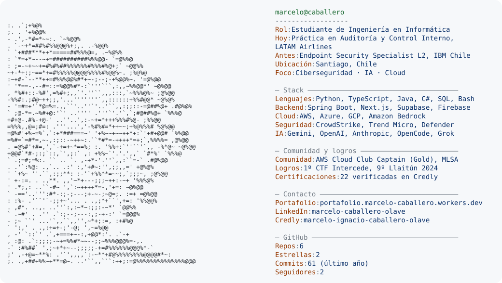

<a href="https://portafolio.marcelo-caballero.workers.dev/">
  <picture>
    <source media="(prefers-color-scheme: dark)" srcset="dark_mode.svg">
    
  </picture>
</a>

**Estudiante de Ingeniería en Informática (Duoc UC), abierto a oportunidades en ciberseguridad, IA y cloud.** Práctica en Auditoría y Control Interno en LATAM Airlines. Antes, Endpoint Security Specialist L2 en IBM Chile, administrando EDR/XDR sobre más de 24.000 endpoints.

### Proyectos destacados

- [**Podocare**](https://github.com/MarceloCaballeroo/Podocare): plataforma de gestión clínica para podología, con Row Level Security, segundo factor (TOTP) y bitácora de auditoría inmutable. Proyecto de título.
- [**Accesibilidad con IA en AWS**](https://github.com/MarceloCaballeroo/botathon-2025-accesibilidad-aws): texto a voz con Polly, voz a texto con Transcribe y asistente con agentes de Bedrock.
- [**ForoHub**](https://github.com/MarceloCaballeroo/forohub): API REST en Spring Boot con autenticación JWT y migraciones Flyway.
- [**Anime Advisor**](https://github.com/MarceloCaballeroo/nerdearla-agente-aws): agente de IA con Strands Agents, hecho en Nerdearla Chile 2026.

### Contacto

[Portafolio](https://portafolio.marcelo-caballero.workers.dev/) · [LinkedIn](https://www.linkedin.com/in/marcelo-caballero-olave) · [Credly](https://www.credly.com/users/marcelo-ignacio-caballero-olave) · [Instagram](https://www.instagram.com/nobu.dev/)

La imagen se regenera todos los días con GitHub Actions (`build.py`): el retrato se genera desde mi foto de perfil y las estadísticas se leen de la API de GitHub.
